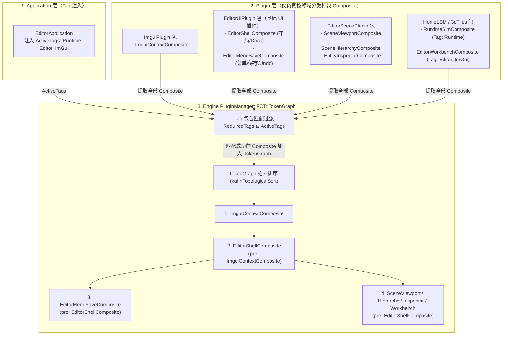

# MQEngine 插件组合体（Composite）架构、TokenGraph 拓扑调度与独立编译分阶段实施计划

> **文档目标**：确立 **“以 `IComposite` 为核心功能与调度单位、`IPlugin` 作为分类与编译包、[`FCT::TokenGraph`](file:///G:/MQEngine/MQEngine/FCT/FCT_RHI/src/Base/TokenGraph.h) 驱动拓扑排序加载、[`Application`](file:///G:/MQEngine/MQEngine/Engine/src/core/application.h) 注入 Tag 包含匹配激发”** 的整体架构；明确 **编辑器 UI 基础插件线（`EditorUiPlugin`）**、**跨插件/跨 Composite 交互机制** 以及 **CMake 插件依赖声明与单插件独立编译（Standalone Build）方案**，并给出分阶段实施计划。

---

## 一、 顶层架构总览

整体架构将**物理分类打包（`Plugin`）**与**逻辑功能调度（`Composite`）**解耦，并与引擎现有的 [`SystemManager`](file:///G:/MQEngine/MQEngine/Engine/src/manager/SystemManager.h) / `RenderGraph` 一脉相承地采用 [`FCT::TokenGraph`](file:///G:/MQEngine/MQEngine/FCT/FCT_RHI/src/Base/TokenGraph.h#L12) 进行有向无环图（DAG）拓扑管理：

1. **[`Engine`](file:///G:/MQEngine/MQEngine/Engine/src/core/engine.h) 层（核心基础系统底座）**
   - 提供跨领域核心子系统（[`Renderer`](file:///G:/MQEngine/MQEngine/Engine/src/renderer/Renderer.h)、[`DataManager`](file:///G:/MQEngine/MQEngine/Engine/src/data/DataManager.h)、[`SystemManager`](file:///G:/MQEngine/MQEngine/Engine/src/manager/SystemManager.h)、[`JobSystem`](file:///G:/MQEngine/MQEngine/Engine/src/manager/JobSystem.h)、[`ResourceLoader`](file:///G:/MQEngine/MQEngine/Engine/src/data/ResourceLoader.h)、[`ScriptSystem`](file:///G:/MQEngine/MQEngine/Engine/src/system/ScriptSystem.h)、[`ComponentReflection`](file:///G:/MQEngine/MQEngine/Engine/src/system/ComponentReflection.h)）与基于 `FCT::TokenGraph` 的 [`PluginManager`](file:///G:/MQEngine/MQEngine/Engine/src/plugin/PluginManager.h)。
2. **`IComposite`（实际功能、依赖与生命周期的最小单元）**
   - 替代原先单体插件的职责。每个 `IComposite` 声明：
     - **唯一标识 `Token`**（`getName()`）
     - **激发标签 `RequiredTags`**（`getRequiredTags()`，由 Application Tags 包含匹配决定是否入图激发）
     - **拓扑前驱 `Predecessors` 与后继 `Successors`**（`getPredecessors()` / `getSuccessors()`，在 `FCT::TokenGraph` 中决定加载、初始化、Tick 与逆序卸载顺序）
3. **[`IPlugin`](file:///G:/MQEngine/MQEngine/Engine/src/plugin/IPlugin.h)（用于分类与内聚打包的 Composite 容器）**
   - `Plugin` 的定位是**对相关性强的 `Composite` 进行分类收敛与物理打包（DLL）**。当引擎读取并装载一个 `Plugin` 时，只是将该插件分类下的所有 `IComposite` 注册进引擎的待调度池中。
4. **[`Application`](file:///G:/MQEngine/MQEngine/Engine/src/core/application.h)（Tag 注入器）**
   - 宿主（`EditorApplication`、`GameApplication`、`LauncherApplication`）注入当前激活的 `Tags`（如 `{"Runtime", "Editor", "ImGui"}`）。引擎筛选所有满足 $\text{RequiredTags} \subseteq \text{ActiveTags}$ 的 `IComposite` 依次加入 `FCT::TokenGraph`，执行拓扑排序后按序加载与初始化。



---

## 二、 核心设计 1：`IComposite` 接口与 `FCT::TokenGraph` 拓扑加载机制

### 2.1 `IComposite` 接口定义（`Engine/src/plugin/IComposite.h`）

```cpp
namespace MQEngine {

struct PluginContext;

/**
 * @brief 功能组合体接口：引擎插件体系中实际承担功能实现、Tag 激发与 TokenGraph 拓扑调度的最小单元
 */
class ENGINE_API IComposite {
public:
    virtual ~IComposite() = default;

    /**
     * @brief 组合体唯一 Token 名称（作为 FCT::TokenGraph 的节点 Token）
     */
    virtual std::string getName() const = 0;

    /**
     * @brief 激发该组合体所需的 Tag 列表（包含匹配：RequiredTags ⊆ ActiveTags 时入图激发）
     */
    virtual std::vector<std::string> getRequiredTags() const = 0;

    /**
     * @brief TokenGraph 拓扑前驱节点 Token 列表（必须在这些 Composite 加载/初始化之后执行）
     */
    virtual std::vector<std::string> getPredecessors() const { return {}; }

    /**
     * @brief TokenGraph 拓扑后继节点 Token 列表（必须在这些 Composite 加载/初始化之前执行）
     */
    virtual std::vector<std::string> getSuccessors() const { return {}; }

    virtual Status onLoad(PluginContext& ctx) { (void)ctx; return OkStatus(); }
    virtual Status onInit(PluginContext& ctx) = 0;
    virtual void onLogicTick(float dt) { (void)dt; }
    virtual void onRenderTick() {}
    virtual void onUnload() {}

    virtual std::string onSerializeHotReloadState() const { return ""; }
    virtual void onRestoreHotReloadState(const std::string& state) { (void)state; }
};

} // namespace MQEngine
```

### 2.2 [`IPlugin`](file:///G:/MQEngine/MQEngine/Engine/src/plugin/IPlugin.h) 退化为纯粹的 `Composite` 分类注册包
- `IPlugin` 主要提供分类元数据（`getName()`、`getVersion()`）与 `Composite` 收集容器：
  ```cpp
  class ENGINE_API IPlugin {
  public:
      virtual ~IPlugin() = default;
      virtual std::string getName() const = 0;
      virtual std::string getVersion() const = 0;

      /**
       * @brief 向当前插件分类包内添加 Composite
       */
      void addComposite(UniquePtr<IComposite> composite);

      template <typename T, typename... Args>
          requires std::derived_from<T, IComposite>
      T* emplaceComposite(Args&&... args) {
          auto comp = makeUnique<T>(std::forward<Args>(args)...);
          T* rawPtr = comp.get();
          addComposite(std::move(comp));
          return rawPtr;
      }

      const std::vector<UniquePtr<IComposite>>& getComposites() const { return m_composites; }

      // 保留默认空实现以向下兼容尚未拆分的旧插件
      virtual Status onLoad(PluginContext& ctx) { (void)ctx; return OkStatus(); }
      virtual Status onInit(PluginContext& ctx) { (void)ctx; return OkStatus(); }
      virtual void onLogicTick(float dt) { (void)dt; }
      virtual void onRenderTick() {}
      virtual void onUnload() {}

  private:
      std::vector<UniquePtr<IComposite>> m_composites;
  };
  ```

### 2.3 基于 [`FCT::TokenGraph`](file:///G:/MQEngine/MQEngine/FCT/FCT_RHI/src/Base/TokenGraph.h) 的 `Composite` 拓扑排序与生命周期调度
在 [`PluginManager`](file:///G:/MQEngine/MQEngine/Engine/src/plugin/PluginManager.h) 内部维护：
```cpp
using CompositeToken = std::string;
using CompositeGraph = FCT::TokenGraph<CompositeToken, CompositeEntry*>;
```
其完整工作流如下：
1. **插件读取与 Composite 注册**：
   - 当读取到插件（DLL 或静态插件）时，调用 `CreatePlugin()` 获取 `IPlugin` 实例，遍历 `plugin->getComposites()`，将每个 `IComposite` 登记到 `PluginManager` 的 `m_composites` 表中（记录其所属 `pluginName`）。
2. **Tag 包含匹配入图（Inclusion Matching $\rightarrow$ `TokenGraph::addNode`）**：
   - 对登记的每个 `CompositeEntry`，检查 `isTagsMatched(composite->getRequiredTags(), m_activeTags)`（即 $\text{RequiredTags} \subseteq \text{ActiveTags}$）。
   - 若匹配成功且尚未入图，则调用：
     ```cpp
     m_compositeGraph.addNode(
         entry.name,
         &entry,
         entry.composite->getPredecessors(),
         entry.composite->getSuccessors()
     );
     ```
   - 若运行时某个 Tag 被移除导致不再匹配，则从 `m_compositeGraph.removeNode(entry.name)` 移除并执行 `onUnload()`。
3. **拓扑排序与按序加载（`TokenGraph::update()` $\rightarrow$ `TokenGraph::order()`）**：
   - 调用 `CHECK_STATUS(m_compositeGraph.update())`，底层通过 Kahn 拓扑排序（[`kahnTopologicalSort`](file:///G:/MQEngine/MQEngine/FCT/FCT_RHI/src/Base/TokenGraph.h#L252)）计算出全局唯一的无环依赖序列 `Vector<CompositeEntry*> sortedOrder = m_compositeGraph.order()`（若存在环路则直接返回 `FailedPreconditionError` 报错）。
   - **按拓扑正序加载与初始化**：依次遍历 `sortedOrder`，对处于 `Unloaded` 状态的 `Composite` 执行 `onLoad(ctx)`，随后再按 `sortedOrder` 顺序对处于 `Loaded` 状态的 `Composite` 执行 `onInit(ctx)`。
   - **按拓扑正序帧更新**：每帧 `logicTick(dt)` 与 `renderTick()` 直接遍历 `m_compositeGraph.order()`。
   - **按拓扑逆序安全卸载**：卸载或关闭工程时，按 `m_compositeGraph.order()` 的**逆序**依次执行 `onUnload()` 并清理各 `Composite` 注册的 ECS `ISystem` 与 `Component`，严格保证下游 `Composite` 先于其依赖的上游 `Composite`（如 `EditorShellComposite`）销毁。

---

## 三、 核心设计 2：插件/Composite 之间的交互机制

### 3.1 编译期与链接期交互（CMake `DEPENDS`）
- 当插件包 `B`（例如 `EditorScenePlugin`）旗下的 `Composite` 需要包含并调用插件包 `A`（例如 `EditorUiPlugin`）公开的 C++ 类或接口时：
  - 在 `EditorScenePlugin/CMakeLists.txt` 中通过 `mq_add_plugin(EditorScenePlugin DEPENDS ImguiPlugin EditorUiPlugin ...)` 指明依赖插件。
  - CMake 自动将 `EditorUiPlugin/include` 加入 `EditorScenePlugin` 的包含路径，并链接 `EditorUiPlugin.lib` 导入库。
  - 插件 `A` 的头文件统一放置在 `Plugins/<PluginA>/src/` 下，由 CMake 自动同步至 `Plugins/<PluginA>/include/<PluginA>/`。

### 3.2 运行期纵向交互：`PluginContext` 强类型服务注册表（Service Registry）
- 上游基础 `Composite`（例如 `EditorUiPlugin` 中的 `EditorShellComposite`）由于在 `TokenGraph` 中作为前驱节点先完成 `onLoad` / `onInit`，它在初始化时向 [`PluginContext`](file:///G:/MQEngine/MQEngine/Engine/src/plugin/PluginContext.h) 注册强类型服务指针：
  ```cpp
  // EditorShellComposite::onInit (上游前驱)
  ctx.registerService<IEditorUiService>(this);
  ```
- 下游 `Composite`（声明了 `getPredecessors() -> {"EditorShellComposite"}`）在按拓扑序执行自身的 `onInit` 时，直接从 `PluginContext` 获取该服务：
  ```cpp
  // SceneViewportComposite::onInit (下游后继，TokenGraph 保证此时 EditorShellComposite 已就绪)
  auto* editorUi = ctx.getService<IEditorUiService>();
  assert(editorUi && "前驱 EditorShellComposite 必须已注册 IEditorUiService");
  editorUi->registerDockWindow("场景视口", EditorDockSlot::Center, true, getName());
  editorUi->registerUiModule(getName(), makeUnique<SceneViewportUiModule>());
  ```

### 3.3 运行期横向交互：`UiContext` 强类型信号与状态总线
- 平级 `Composite` 之间（如 `SceneHierarchyComposite` 与 `EntityInspectorComposite`）无需在 CMake 中互相链接对方所在的插件 DLL，也不必构成硬性前驱依赖。
- 它们统一通过 `EditorUiPlugin` 公开的 [`UiContext`](file:///G:/MQEngine/MQEngine/Applications/Editor/src/UI/UiContext.h) 发送编译期强类型信号（`ctx.emit(SelectSceneEntitySignal{...})`）或读取共享视图状态（`ctx.state<SceneEntityViewState>()`），在逻辑帧由 `EditorShellComposite` 统一安全分发。

---

## 四、 核心设计 3：引擎本体插件与用户插件区分、CMake 依赖声明及单插件独立编译

### 4.1 仓库目录分层架构：`Engine/` 与 `UserCode/` 的物理隔离
为将引擎本体核心、引擎内置插件与用户项目、用户插件彻底区分开来，工程目录统一收敛为 **`Engine/`（引擎本体空间）** 与 **`UserCode/`（用户空间）** 两大顶层区域：

```text
MQEngine/
├── Engine/
│   ├── Core/                  # 原 Engine/ 下的引擎核心底座（src/、include/、CMakeLists.txt）
│   └── Plugins/               # 引擎本体内置插件（PluginScope::Engine）
│       ├── ImguiPlugin/       # ImGui / ImNodes 渲染上下文插件
│       ├── EditorUiPlugin/    # 编辑器 UI 基础框架插件（DockSpace 布局、保存、主菜单、UndoRedo）
│       ├── EditorScenePlugin/ # 编辑器场景视口、实体大纲、反射检视器插件
│       ├── EditorAssetPlugin/ # 编辑器内容浏览器、脚本管理器插件
│       ├── EditorShaderPlugin/# 编辑器 ShaderGraph、着色器与 RenderGraph 查看器插件
│       ├── GodotImporter/     # Godot 场景/脚本导入内置插件
│       └── McpPlugin/         # MCP 自动化控制内置插件
│
└── UserCode/
    ├── Projects/              # 原 Example/ 下的项目工程（如 DemoProject/project.mq、CesiumProject/）
    ├── Plugins/               # 用户与垂直领域插件（PluginScope::User，如 HomeLBM/、3dTiles/）
    ├── Native/                # 用户原生 C++ 业务模块
    └── Templates/             # 项目与脚本生成模板
```

| 维度 | 引擎本体插件 (`PluginScope::Engine` / `BUILTIN`) | 用户插件 (`PluginScope::User`) |
| :--- | :--- | :--- |
| **源码存放目录** | `MQEngine/Engine/Plugins/<PluginName>`<br/>（兼容旧路径 `MQEngine/Plugins/<PluginName>`） | 1. `MQEngine/UserCode/Plugins/<PluginName>`<br/>2. 或具体工程 `<ProjectDir>/Plugins/<PluginName>` |
| **典型插件代表** | `ImguiPlugin`、`EditorUiPlugin`、`EditorScenePlugin`、`EditorAssetPlugin`、`EditorShaderPlugin`、`GodotImporter`、`McpPlugin` | `HomeLBM`、`3dTiles`、用户为特定项目编写的渲染/玩法/工具插件 |
| **CMake 构建方式** | 声明 `mq_add_plugin(<Name> BUILTIN ...)`（或位于 `Engine/Plugins/` 下自动识别为 `BUILTIN`）；既随引擎构建，也支持独立编译 | 声明 `mq_add_plugin(<Name> ...)`；**无需加入引擎根 `CMakeLists.txt`**，直接通过 [`Config/MQPluginSDK.cmake`](file:///G:/MQEngine/MQEngine/Config/MQPluginSDK.cmake) 独立配置与编译 |
| **加载与卸载时机** | `Engine::init()` 启动时由引擎自动扫描加载，其 `Composite` 根据 `Application` 注入的 `Tags` 自动激发；**切换或关闭用户工程时不卸载** | 由用户工程 `UserCode/Projects/<Proj>/project.mq` 的 `plugins = [...]` 声明并在 `ProjectManager::openProject` 时按需加载，在 `closeProject` 时卸载 |
| **工程配置持久化** | 属于宿主固有底座，**不会**被写入具体项目的 `project.mq` 配置中 | 在编辑器中勾选启用并保存工程设置时，自动持久化记录到 `project.mq` |

### 4.2 为什么必须支持单插件独立编译？
- 目前所有插件必须在根 [`MQEngine/CMakeLists.txt`](file:///G:/MQEngine/MQEngine/CMakeLists.txt) 中通过 `add_subdirectory` 加入才能编译，一旦新增或迭代某个外部/独立插件，都要重新配置整棵引擎 CMake 树。
- 我们需要做到：**任何一个插件目录本身就是一个完整的、可独立运行 `cmake -S <PluginDir> -B <BuildDir>` 的 CMake 工程**，同时也能在引擎全量构建时被 `add_subdirectory` 内嵌编译。

### 4.2 `Config/MQPluginSDK.cmake` + `MQEngineSDKConfig.cmake` 实现方案

#### 1. 引擎构建时自动导出 SDK 描述文件 `MQEngineSDKConfig.cmake`
在根 [`CMakeLists.txt`](file:///G:/MQEngine/MQEngine/CMakeLists.txt) 尾部调用 `mq_export_engine_sdk()`，在引擎构建目录（如 `Output/build-windows-debug/MQEngineSDKConfig.cmake`）自动生成 SDK 导入配置：
- 导出 `MQENGINE_ROOT_DIR`、`MQENGINE_BUILD_DIR`、`VCPKG_INSTALLED_DIR`。
- 导出 `FCT_Base`、`FCT_SAI`、`FCT`、`FCT_IMGUI`、`FCT_Node`、`NBR`、`FCT_PyBri`、`FCT_Compute`、`Engine` 的 `IMPORTED` 目标（附带 `.lib` 路径与 `include/` 目录）。
- 导出预编译反射工具 `mq_reflect` 的 `IMPORTED` 可执行目标。
- 导出所有已构建基础插件（如 `ImguiPlugin`、`EditorUiPlugin`）的 `SHARED IMPORTED` 目标（附带各自的 `.lib` 导入库与 `include/` 路径）。

#### 2. 统一的插件 CMake 编写范式（支持 `DEPENDS` 与独立编译）
每个插件的 `CMakeLists.txt` 统一采用如下结构：

```cmake
cmake_minimum_required(VERSION 3.22.1)
project(EditorScenePlugin LANGUAGES CXX)

# 若当前插件作为顶层 CMake 单独构建 (Standalone 模式)，自动定位并加载 MQPluginSDK.cmake
if(CMAKE_SOURCE_DIR STREQUAL CMAKE_CURRENT_SOURCE_DIR)
    if(NOT DEFINED MQENGINE_ROOT_DIR)
        get_filename_component(MQENGINE_ROOT_DIR "${CMAKE_CURRENT_SOURCE_DIR}/../.." ABSOLUTE)
    endif()
    include("${MQENGINE_ROOT_DIR}/Config/MQPluginSDK.cmake")
endif()

mq_add_plugin(EditorScenePlugin
    VERSION "1.0.0"
    DEPENDS
        ImguiPlugin
        EditorUiPlugin
    SOURCES
        ${PLUGIN_SOURCES}
    HEADERS
        ${PLUGIN_HEADERS}
)
```

`mq_add_plugin` 内部逻辑：
1. **自动识别构建模式**：
   - **In-Tree 模式**（被根 `CMakeLists.txt` `add_subdirectory`）：直接链接当前 CMake 进程中的 `Engine` 与 `DEPENDS` 插件目标，并将当前插件追加注册到 `MQEngineSDKConfig.cmake` 导出列表中。
   - **Standalone 模式**（单独对插件目录执行 `cmake`）：自动加载 `${MQENGINE_BUILD_DIR}/MQEngineSDKConfig.cmake`（默认指向 `Output/build-windows-debug`），将 `Engine` 及 `DEPENDS` 中声明的 `ImguiPlugin`、`EditorUiPlugin` 作为预编译 `IMPORTED` 库直接链接，**仅编译当前插件自身的 `.cpp` 文件**。
2. **自动处理跨插件头文件与 DLL 部署**：
   - 自动将 `./src/*.h` 拷贝至 `./include/<PluginName>/` 并暴露给下游依赖它的插件；
   - 编译完成后自动将生成的 `<PluginName>.dll` 同步至 `${MQENGINE_BUILD_DIR}/Plugins/<PluginName>/` 与宿主运行目录，直接配合引擎热重载生效。

---

## 五、 核心设计 4：编辑器 UI 基础插件（`EditorUiPlugin`）与插件线规划

### 5.1 编辑器 UI 基础插件 `EditorUiPlugin`（插件线根基）
- **位置**：`Plugins/EditorUiPlugin`
- **CMake 依赖**：`DEPENDS ImguiPlugin`
- **包含的 `Composite` 节点（均要求 `RequiredTags: {"Editor", "ImGui"}`）**：
  1. **`EditorShellComposite`**
     - **TokenGraph 前驱**：`{"ImguiComposite"}`
     - **核心职责**：
       - 管理主窗口 `DockSpace` 布局框架，提供动态停靠槽位注册接口 `registerDockWindow(windowTitle, EditorDockSlot, focusOnReset, ownerComposite)`，彻底取代原 [`UiLayer::setupDefaultLayout`](file:///G:/MQEngine/MQEngine/Applications/Editor/src/UI/UiLayer.cpp#L169-L216) 的硬编码窗口名。
       - 托管全局 [`UiContext`](file:///G:/MQEngine/MQEngine/Applications/Editor/src/UI/UiContext.h)（强类型 `ViewState` 同步与 `Signal` 队列分发）与 `IUiModule` 容器。
       - 向 `PluginContext` 注册 `IEditorUiService` 服务接口。
  2. **`EditorMenuAndSaveComposite`**
     - **TokenGraph 前驱**：`{"EditorShellComposite"}`
     - **核心职责**：
       - 提供场景保存（`saveActiveScene`）、工程配置保存（`saveProjectSettings`）与窗口关闭保存钩子（`WindowCloseSave`）。
       - 挂载可扩展顶栏主菜单（支持下游 `Composite` 调用 `registerMenuItem(category, label, shortcut, callback, ownerComposite)` 动态添加菜单项）。
       - 托管 [`UndoManager`](file:///G:/MQEngine/MQEngine/Applications/Editor/src/command/UndoManager.h)、全局快捷键（`Ctrl+S` / `Ctrl+Z` / `Ctrl+Y` / `F5`）、Play/Stop 状态切换以及编辑器共享选中态（`EditorSelectionState` / `editorRegistry`）。
  3. **`EditorDiagnosticsComposite`**
     - **TokenGraph 前驱**：`{"EditorShellComposite"}`
     - **核心职责**：提供基础 [`LogWindow`](file:///G:/MQEngine/MQEngine/Applications/Editor/src/imgui/LogWindow.h)（日志窗口）与调试内存分析面板。

### 5.2 依赖 `EditorUiPlugin` 的下游插件与 `Composite` 拓扑图
下游所有编辑器 UI 插件在 CMake 中声明 `DEPENDS ImguiPlugin EditorUiPlugin`，其内部的各个 `Composite` 在 `getPredecessors()` 中声明 `"EditorShellComposite"`（或 `"EditorMenuAndSaveComposite"`），由 `FCT::TokenGraph` 自动保证在基础 UI 框架就绪后按拓扑序加载：

| 所属插件包（分类） | 内部包含的 `IComposite` | `RequiredTags` | `TokenGraph` 前驱 (`Predecessors`) | 功能说明 |
| :--- | :--- | :--- | :--- | :--- |
| **`ImguiPlugin`** | `ImguiComposite` | `{"ImGui"}` | `{}` | 创建 `FCT::ImguiContext`、`ImNodesContext` 并注册 `ImguiPass` |
| **`EditorUiPlugin`** | `EditorShellComposite`<br/>`EditorMenuAndSaveComposite`<br/>`EditorDiagnosticsComposite` | `{"Editor", "ImGui"}` | `{"ImguiComposite"}`<br/>`{"EditorShellComposite"}`<br/>`{"EditorShellComposite"}` | 编辑器 DockSpace 布局框架、`UiContext`、保存、主菜单、UndoRedo、日志窗口 |
| **`EditorScenePlugin`** | `SceneViewportComposite`<br/>`CameraControlComposite`<br/>`SceneHierarchyComposite`<br/>`EntityInspectorComposite` | `{"Editor", "ImGui"}` | `{"EditorShellComposite"}` | 场景视口与 `EditorCameraManager`、相机控制、场景实体大纲树、实体组件反射检视器 |
| **`EditorAssetPlugin`** | `ContentBrowserComposite`<br/>`ScriptManagerComposite`<br/>`AssetInspectorComposite` | `{"Editor", "ImGui"}` | `{"EditorShellComposite"}` | 内容浏览器（场景/模型/片段提供者）、脚本管理器、资源细节面板 |
| **`EditorShaderPlugin`** | `ShaderGraphComposite`<br/>`ShaderEditorComposite`<br/>`RenderGraphViewerComposite` | `{"Editor", "ImGui"}` | `{"EditorShellComposite", "ContentBrowserComposite"}` | 节点式 ShaderGraph 编辑器、HLSL 着色器编辑器、RenderGraph 拓扑与贴图查看器 |
| **`HomeLBM` / `3dTiles`** | `HomeLbmRuntimeComposite`<br/>`HomeLbmEditorComposite`<br/>`Tiles3dRuntimeComposite` | `{"Runtime"}`<br/>`{"Editor", "ImGui"}`<br/>`{"Runtime"}` | `{}`<br/>`{"EditorShellComposite", "HomeLbmRuntimeComposite"}`<br/>`{}` | 领域插件包内同时分类收纳 Runtime 组合体与 Editor 调试面板组合体 |

---

## 六、 分步骤阶段计划与实现路线（Phased Implementation Plan）

### 阶段一（Phase 1）：CMake 插件 SDK 化、依赖声明与单插件独立编译
1. 新增 `Config/MQPluginSDK.cmake`，实现 `mq_add_plugin(NAME ... DEPENDS ... SOURCES ... HEADERS ...)` 与 `mq_export_engine_sdk()`。
2. 修改根 [`CMakeLists.txt`](file:///G:/MQEngine/MQEngine/CMakeLists.txt) 与 [`Engine/CMakeLists.txt`](file:///G:/MQEngine/MQEngine/Engine/CMakeLists.txt)，在构建时生成 `${CMAKE_BINARY_DIR}/MQEngineSDKConfig.cmake`。
3. 升级 [`Plugins/ImguiPlugin/CMakeLists.txt`](file:///G:/MQEngine/MQEngine/Plugins/ImguiPlugin/CMakeLists.txt) 与 [`Plugins/HomeLBM/CMakeLists.txt`](file:///G:/MQEngine/MQEngine/Plugins/HomeLBM/CMakeLists.txt)，支持顶层 `project(...)` 与独立构建。
4. **验证**：在外部独立 build 目录单独对 `HomeLBM` 执行 `cmake` 与 `cmake --build`，确认无需经过根 `CMakeLists.txt` 即可独立编译出 `.dll`。

### 阶段二（Phase 2）：`IComposite` 接口、`FCT::TokenGraph` 拓扑加载与 Tag 包含匹配
1. 新增 `Engine/src/plugin/IComposite.h`，定义 `getName()`、`getRequiredTags()`、`getPredecessors()`、`getSuccessors()` 及生命周期钩子。
2. 升级 [`Engine/src/plugin/IPlugin.h`](file:///G:/MQEngine/MQEngine/Engine/src/plugin/IPlugin.h) 为 `Composite` 容器包（提供 `emplaceComposite<T>`），并在 [`PluginContext`](file:///G:/MQEngine/MQEngine/Engine/src/plugin/PluginContext.h) 中加入跨插件强类型服务注册表 `registerService<T>` / `getService<T>`。
3. 重构 [`Engine/src/plugin/PluginManager.h`](file:///G:/MQEngine/MQEngine/Engine/src/plugin/PluginManager.h) 与 [`PluginManager.cpp`](file:///G:/MQEngine/MQEngine/Engine/src/plugin/PluginManager.cpp)：
   - 引入 `FCT::TokenGraph<std::string, CompositeEntry*> m_compositeGraph`；
   - 实现 `ActiveTags` 包含匹配过滤（$\text{RequiredTags} \subseteq \text{ActiveTags}$），将匹配的 `IComposite` 依次加入 `m_compositeGraph`，调用 `m_compositeGraph.update()` 进行拓扑排序；
   - 按 `m_compositeGraph.order()` 拓扑正序执行 `onLoad` / `onInit` / `onLogicTick` / `onRenderTick`，按拓扑逆序执行 `onUnload` 与资源回滚。
4. 在 [`Application`](file:///G:/MQEngine/MQEngine/Engine/src/core/application.h) 中新增 `getTags()`，并在 [`Engine::init`](file:///G:/MQEngine/MQEngine/Engine/src/core/engine.cpp#L566-L654) 中将 Tags 注入 `PluginManager`。
5. **验证**：编译 `Engine` 并通过测试验证多个具有前驱/后继依赖关系的 `IComposite` 在不同 `Application` Tags 下按 `TokenGraph` 拓扑序准确激发与逆序卸载。

### 阶段三（Phase 3）：实现编辑器 UI 基础插件 `Plugins/EditorUiPlugin`
1. 新建 `Plugins/EditorUiPlugin`（`CMakeLists.txt` 声明 `DEPENDS ImguiPlugin`，支持独立编译）。
2. 提炼并导出 `IEditorUiService.h`、`UiContext.h`、`UiSignals.h`、`IUiModule.h`、`DeclarativeUiBinder.h`、`UndoManager.h`、`ICommand.h` 至 `EditorUiPlugin`。
3. 将 [`ImguiPlugin`](file:///G:/MQEngine/MQEngine/Plugins/ImguiPlugin/src/ImguiPlugin.h) 内部包装为 `ImguiComposite`（Token: `"ImguiComposite"`，Tag: `{"ImGui"}`）。
4. 在 `EditorUiPlugin` 内实现：
   - `EditorShellComposite`（前驱 `"ImguiComposite"`：负责动态 DockSpace 槽位注册表与模块渲染调度）
   - `EditorMenuAndSaveComposite`（前驱 `"EditorShellComposite"`：负责场景/工程保存、窗口关闭自动保存、可扩展顶栏主菜单、UndoRedo、全局快捷键与共享选中态）
   - `EditorDiagnosticsComposite`（前驱 `"EditorShellComposite"`：负责日志窗口与内存分析面板）
5. **验证**：单独编译与集成编译 `EditorUiPlugin`，验证基础编辑器框架、布局重置、保存与菜单扩展点正常工作。

### 阶段四（Phase 4）：迁移下游编辑器 UI 插件线并瘦身 `EditorApplication`
1. 建立下游编辑器插件包（均声明 `DEPENDS ImguiPlugin EditorUiPlugin` 并支持独立编译）：
   - `Plugins/EditorScenePlugin`（包含 `SceneViewportComposite`、`CameraControlComposite`、`SceneHierarchyComposite`、`EntityInspectorComposite`，前驱均为 `"EditorShellComposite"`）
   - `Plugins/EditorAssetPlugin` 与 `Plugins/EditorShaderPlugin`（包含 `ContentBrowserComposite`、`ScriptManagerComposite`、`ShaderGraphComposite`、`ShaderEditorComposite`、`RenderGraphViewerComposite`）
2. 瘦身 [`Applications/Editor`](file:///G:/MQEngine/MQEngine/Applications/Editor)：移除已迁出的 UI 业务代码，[`EditorApplication`](file:///G:/MQEngine/MQEngine/Applications/Editor/src/core/EditorApplication.h) 仅保留 `renderConfig()` 与 `getTags() -> {"Runtime", "Editor", "ImGui"}`。
3. **验证**：启动 `Editor.exe`，确认 `TokenGraph` 按拓扑序：`ImguiComposite` $\rightarrow$ `EditorShellComposite` $\rightarrow$ `EditorMenuAndSaveComposite` / 各业务面板 `Composite` 依次加载，UI 布局与交互完整无损。

### 阶段五（Phase 5）：领域插件（`HomeLBM` / `3dTiles`）Composite 化与独立编译闭环
1. 将 [`HomeLbmPlugin`](file:///G:/MQEngine/MQEngine/Plugins/HomeLBM/src/HomeLbmPlugin.h) 拆分为 `HomeLbmRuntimeComposite`（Tag: `{"Runtime"}`）与 `HomeLbmEditorComposite`（Tag: `{"Editor", "ImGui"}`，前驱: `{"EditorShellComposite", "HomeLbmRuntimeComposite"}`）。
2. 将 [`Tiles3dPlugin`](file:///G:/MQEngine/MQEngine/Plugins/3dTiles/src/Tiles3dPlugin.h) 封装为 `Tiles3dRuntimeComposite`（Tag: `{"Runtime"}`）。
3. **验证**：测试 `Editor` 与 `Game` 不同宿主 Tag 下的按需激发，以及单插件独立编译 + 运行时热重载完整闭环。
